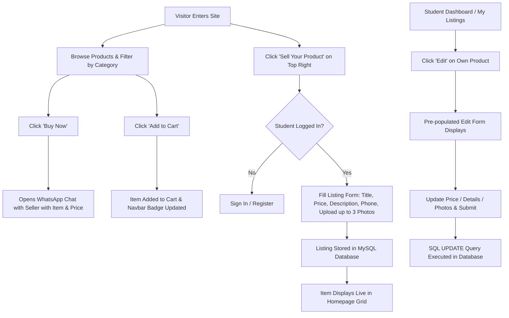

# 📑 CBSE Class 12 Computer Science Project Report
## Project Title: School Peer-to-Peer E-Commerce Marketplace
**Language:** Python 3.x (Flask Framework)  
**Database:** MySQL / MariaDB (with SQLite fallback)  
**Front-End:** HTML5, CSS3 (Glassmorphism & Responsive Design), JavaScript (Vanilla)

---

### 1. Introduction & Objective
In high schools, senior students often have surplus academic resources such as expensive NCERT reference books, practical project electronic kits (Arduino/microcontrollers), and handwritten topper revision notes. Meanwhile, junior students seek affordable study materials. 

The objective of this project is to develop a lightweight, user-friendly, peer-to-peer web marketplace enabling students to buy, sell, and trade school supplies directly within their school community, eliminating intermediaries and allowing direct WhatsApp communication with sellers.

---

### 2. System Requirements
- **Operating System:** Windows 10/11, Linux, or macOS
- **Language Environment:** Python 3.10+
- **Python Libraries:** `Flask`, `mysql-connector-python`, `pymysql`, `Werkzeug`
- **Database Engine:** MySQL Server 8.0 / XAMPP / MariaDB (or SQLite3)
- **Web Browser:** Google Chrome, Edge, Firefox, or Safari

---

### 3. Database Design & Tables
The system database (`school_ecom_db`) consists of three normalized relational tables:

1. **`users` Table:**
   - `id` (INT, Primary Key, Auto-increment)
   - `full_name` (VARCHAR(100), Student name)
   - `student_class` (VARCHAR(50), e.g., "Class 12 - Science")
   - `email` (VARCHAR(100), Unique school email)
   - `phone` (VARCHAR(20), Contact number)
   - `password_hash` (VARCHAR(255), Secure hashed password)
   - `created_at` (TIMESTAMP)

2. **`products` Table:**
   - `id` (INT, Primary Key, Auto-increment)
   - `user_id` (INT, Foreign Key referencing `users(id)`)
   - `title` (VARCHAR(150), Item title)
   - `category` (VARCHAR(50), e.g., Textbooks, Notes, Electronics)
   - `price` (DECIMAL(10,2), Item price in ₹)
   - `phone` (VARCHAR(20), Seller's WhatsApp contact)
   - `description` (TEXT, Detailed condition and notes)
   - `image_1`, `image_2`, `image_3` (VARCHAR(255), File paths of up to 3 uploaded images)
   - `status` (VARCHAR(20), Default: 'available')
   - `created_at` (TIMESTAMP)

3. **`cart_items` Table:**
   - `id` (INT, Primary Key, Auto-increment)
   - `user_id` (INT, Foreign Key referencing `users(id)`)
   - `product_id` (INT, Foreign Key referencing `products(id)`)
   - `quantity` (INT, Item quantity)
   - `created_at` (TIMESTAMP)

---

### 4. Key Workflows

---

### 5. Frequently Asked Viva Voce Questions & Answers
1. **Q: What is the role of Flask in this project?**  
   *A:* Flask is a lightweight Python WSGI web application framework. It routes HTTP requests, handles session cookies, interacts with the MySQL database via Python drivers, and renders dynamic HTML templates using Jinja2.

2. **Q: Why is password hashing used instead of plain text storage?**  
   *A:* Plain text password storage is insecure. In this project, passwords are transformed into irreversible cryptographic hashes using Werkzeug (`generate_password_hash` with scrypt/pbkdf2), protecting user credentials from unauthorized exposure.

3. **Q: How does the student listing modification / edit feature work?**  
   *A:* The edit endpoint (`/product/edit/<id>`) verifies session ownership (`user_id == product.user_id`), pre-fills the form with existing data, allows replacing or keeping current images, and performs a parameterized SQL `UPDATE` statement via `database.update_product()`.

4. **Q: How does the direct WhatsApp integration work?**  
   *A:* It uses the official WhatsApp Universal Link protocol (`https://wa.me/<number>?text=<encoded_message>`). Python sanitizes the 10-digit mobile number, prepends country code `91`, and URL-encodes a formatted greeting message.
